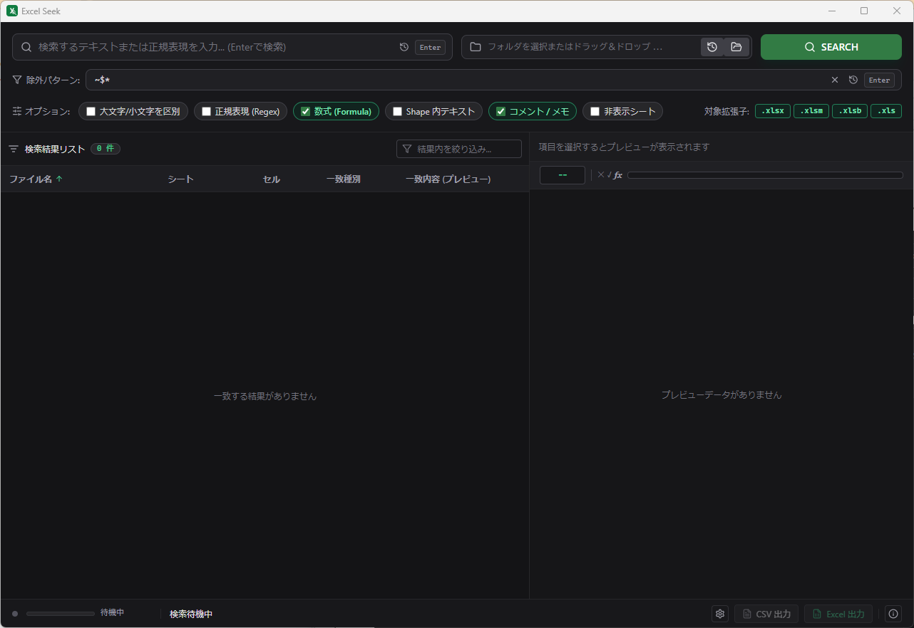
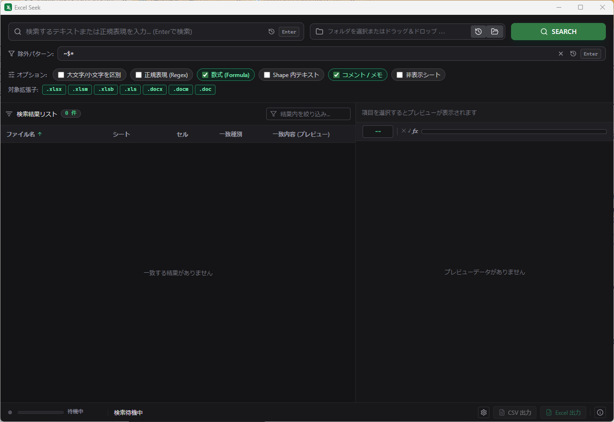

# Excel Seek (`xlseek`)

[](LICENSE)

[English](README.md) | **日本語**

**Excel Seek (`xlseek`)** は、Excel ワークブック（`.xlsx`、`.xlsm`、`.xlsb`、`.xls`）および Microsoft Word 文書（`.docx`、`.docm`、`.doc`）を対象に、フォルダ単位で高速・軽量かつセキュアに再帰検索できるデスクトップ検索アプリケーションおよび CLI ツールです。セルの値、数式、コメント/メモ、Word 本文段落、図形（Shape）内テキストを、通常の文字列または正規表現を用いて横断検索できます。


*Excel 検索モード（初期状態）*


*設定で Word 文書検索を有効化した状態（`.docx`、`.docm`、`.doc`）*

---

## 主な機能

- **マルチフォーマット対応**:
  - **Excel ワークブック**: 指定したディレクトリ配下の `.xlsx`、`.xlsm`、`.xlsb`、`.xls` ファイルを再帰的に検索。
  - **Word 文書**: `.docx`、`.docm`、`.doc` ファイルの検索に対応（設定画面からのオプトイン）。有効化すると検索バーに拡張子トグルが動的に追加され、個別に対象を切り替え可能。
- **複数検索パスの一括指定**: カンマ区切りで複数のフォルダやファイルパスを指定可能。空白やカンマを含むパスはダブルクオートで囲むことで安全に処理（例: `"/Volumes/Data, 2026", "C:\My Reports"`）。
- **除外ファイルパターン指定（.gitignore 形式）**:
  - `.gitignore` 構文のワイルドカードパターン（カンマ区切り、例: `~$*, *.tmp, backup/`）を用いて、一時ファイルやバックアップフォルダを検索から除外。
  - Office のテンポラリ・ロックファイルを除外するため、初期値として `~$*` がプリセット。
  - 履歴保存・ドロップダウン選択、設定画面（保存された既定値）での既定パターンカスタマイズ、除外フォルダの走査スキップによる高速化に対応。
- **柔軟な検索オプション**:
  - 大文字・小文字の区別 / 非区別。
  - 正規表現（Regex）検索。
  - セル値、数式、コメント/メモ、図形（Shape）内テキストの検索対象切り替え（Excel）。
  - 本文段落・表、ヘッダー/フッター、コメント、図形内テキストの検索（Word）。
  - 非表示シートの検索対象への追加 / 除外（Excel）。
- **高速かつ並列化された走査**: 高パフォーマンスなスプレッドシート解析ライブラリ [calamine](https://github.com/tafia/calamine) と、マルチスレッド並列処理ライブラリ [rayon](https://github.com/rayon-rs/rayon) を採用。
- **リッチプレビューと直接起動**:
  - **スプレッドシートグリッド表示**: Excel ファイルの一致セル、数式、周辺セルをプレビューグリッドで確認。
  - **テキストドキュメント表示**: Word ファイルの一致段落を自然なテキスト形式で閲覧（行・段落番号表示、キーワードハイライト、該当箇所への自動スクロール）。
  - **外部連携**: システム既定のアプリや検出された表計算アプリで直接開くほか、OS のファイルマネージャー（Explorer、Finder、Linux ファイルマネージャー）で該当ファイルをハイライト表示可能。
- **検索履歴と入力補完**: 直近の検索キーワード、対象ディレクトリパス、除外パターンを履歴として保持し、パスの入力補完をサポート。
- **エクスポート機能**: 検索結果を CSV または整形された Excel（`.xlsx`）ファイルとして直接保存。
- **ヘッドレス CLI 同梱**: GUI を起動せずにバッチ検索、ファイル出力、または標準出力（stdout）への CSV ストリーミングが可能な `xlseek-cli` を提供。
- **バイリンガル対応**: 日本語と英語の UI 切り替え、デフォルト検索オプションおよび履歴件数の設定が可能。
- **クロスプラットフォーム対応（デスクトップ & CLI）**: Windows、macOS、Linux をネイティブサポート。各 OS のファイルマネージャー（Explorer、Finder、DBus ShowItems / xdg-open）連携や表計算アプリの直接起動に対応。
- **オープンソース情報の透明性**: About ダイアログからアプリケーション情報、バージョン、およびサードパーティ OSS ライセンス条項を確認可能。

> **検索オプションの既定値**: 数式の検索は既定で有効です。図形内テキストと非表示シートは既定で除外されています。Excel 対象拡張子 4 形式（`.xlsx`、`.xlsm`、`.xlsb`、`.xls`）および一時ファイル除外パターン（`~$*`）は既定で有効です。Word 文書検索（`.docx`、`.docm`、`.doc`）は初期状態では無効となっており、設定画面から有効化できます。

---

## 技術スタック

| 領域 | 採用技術 |
| :--- | :--- |
| **デスクトップ基盤** | [Tauri v2](https://tauri.app/) |
| **フロントエンド** | React 18, TypeScript, Vite, Tailwind CSS, Lucide React |
| **バックエンド & コアエンジン** | Rust 2021 edition |
| **ドキュメントパーサー** | `calamine` (Excel), `quick-xml` + `zip` (OOXML Word), `cfb` (旧形式 Word バイナリ) |
| **並列処理** | `rayon` |
| **パターン・グロブマッチング** | `regex`, `ignore` / `globset` |
| **エクスポート** | `csv`, `rust_xlsxwriter` |

---

## プラットフォーム対応

Excel Seek は、Windows、macOS、Linux の各 OS にネイティブ対応し、デスクトップおよび CLI の双方でシームレスな操作性を提供します。

| プラットフォーム | 対応バージョン / アーキテクチャ | パッケージ形式 | ファイルマネージャー連携 | 表計算アプリ検出 |
| :--- | :--- | :--- | :--- | :--- |
| **Windows** | Windows 10, 11 (x64) | NSIS インストーラー (`.exe`)、WiX (`.msi`) | エクスプローラー (`explorer.exe /select,<path>`) | Microsoft Excel、LibreOffice Calc、WPS Office（レジストリ経由） |
| **macOS** | macOS 11.0+ (Apple Silicon) | ディスクイメージ (`.dmg`)、アプリバンドル (`.app`) | Finder (`open -R <path>`) | Microsoft Excel、Apple Numbers、LibreOffice Calc（`/Applications` 配下） |
| **Linux** | Ubuntu, Debian, Fedora, Arch Linux (x86_64) | Debian パッケージ (`.deb`)、AppImage (`.AppImage`) | DBus `FileManager1` (Nautilus, Dolphin, Nemo) / `gio` / `xdg-open` / WSL `explorer.exe` | システム既定の表計算アプリ |

### 各プラットフォームの特長

- **Windows**:
  - レジストリ（`OpenWithProgids` / `UserChoice`）からインストール済みの表計算アプリを自動検出し、開くアプリ候補として提示。
  - 「フォルダで開く」操作でエクスプローラーを起動し、該当ファイルを自動選択・ハイライト表示（`explorer.exe /select,`）。
  - `rundll32.exe shell32.dll,OpenAs_RunDLL` を呼び出し、Windows 標準の「別のプログラムで開く」ダイアログを表示。
  - Microsoft Edge WebView2（Windows 10 バージョン 1803 以降および Windows 11 に標準搭載）を使用。
- **macOS**:
  - Apple Silicon（`aarch64-apple-darwin`）をネイティブサポート。
  - `/Applications` 配下を走査し、Microsoft Excel、Apple Numbers、LibreOffice Calc を自動認識。
  - 「フォルダで開く」操作で Finder を起動し、該当ファイルを自動選択（`open -R`）。
  - ネイティブのファイル選択ダイアログから `/Applications` 内の任意のアプリを選択して起動可能。
- **Linux**:
  - WebKitGTK および GTK 3 を基盤とし、主要なデスクトップ環境（GNOME, KDE Plasma, XFCE, Cinnamon 等）で動作。
  - FreeDesktop 標準の DBus `org.freedesktop.FileManager1.ShowItems` を介して、GNOME Files（Nautilus）、KDE Dolphin、Nemo、PCManFM-Qt 等のファイルマネージャーで該当ファイルをハイライト表示（非対応環境では `gio open` / `xdg-open` へフォールバック）。
  - **WSL（Windows Subsystem for Linux）対応**: WSL 環境を自動検知し、`wslpath` によるパス変換を経て Windows のエクスプローラーで安全に表示。

---

## 前提条件と開発手順

### 必要要件

- **Node.js & npm**（v18+ LTS 推奨）
- **Rust stable & Cargo**（2021 edition）
- **プラットフォーム固有のビルド要件**:
  - **Windows**:
    - [Microsoft C++ Build Tools](https://visualstudio.microsoft.com/visual-cpp-build-tools/) または「C++ によるデスクトップ開発」を有効にした Visual Studio
    - [Microsoft Edge WebView2 ランタイム](https://developer.microsoft.com/ja-jp/microsoft-edge/webview2/)（Windows 10/11 に標準搭載）
  - **macOS**:
    - Xcode Command Line Tools（`xcode-select --install`）
  - **Linux (Debian / Ubuntu)**:
    - システムパッケージ:
      ```bash
      sudo apt-get update && sudo apt-get install -y \
        build-essential \
        curl \
        wget \
        file \
        libxdo-dev \
        libssl-dev \
        libayatana-appindicator3-dev \
        librsvg2-dev \
        libwebkit2gtk-4.1-dev
      ```
      *（WebKitGTK 4.0 を採用するディストリビューションでは `libwebkit2gtk-4.0-dev` を使用）*

### はじめ方

```bash
# リポジトリのクローン
git clone https://github.com/soakaye/xlseek.git
cd xlseek

# フロントエンド依存関係のインストール
npm install

# Tauri デスクトップウィンドウを起動して開発サーバーを開始
npm run tauri dev
```

---

## コマンドラインインターフェース (CLI)

Tauri インストーラーには `xlseek-cli` が Sidecar として同梱されます。GUI を起動したり、CLI を別途インストールしたりせずに、端末から直接実行できます。開発時には Cargo で単体の CLI 実行ファイルをビルドできます：

```bash
# ホスト環境向けの単体 CLI バイナリをビルド
cargo build --release -p xlseek-cli --bin xlseek-cli

# ヘルプと利用可能なオプションを表示
./target/release/xlseek-cli --help

# 実行例: 位置引数構文で検索し、CSV を標準出力（stdout）へストリーミング
./target/release/xlseek-cli "Revenue" ./reports

# 実行例: 検索を実行して XLSX へエクスポート（拡張子から形式を自動推論）
./target/release/xlseek-cli -p ./reports -q "Revenue" -o ./results.xlsx

# 実行例: 除外パターンと英語の見出しを指定して複数フォルダを検索し、CSV へエクスポート
./target/release/xlseek-cli -p "./reports, ./archive" -q "Revenue" \
  -i "~$*, *.tmp, backup/*" -f csv -o ./results.csv -l en
```

Windows では、この Cargo コマンドで生成される単体の実行ファイルは `target\release\xlseek-cli.exe` です。パッケージ生成時には対象環境向けの CLI を自動的にビルドし、Tauri 用に配置します。

### インストール済みパッケージから CLI を実行する

デスクトップ版のインストーラーには、CLI バイナリ `xlseek-cli` が Tauri Sidecar として同梱されています。Sidecar バイナリは（Linux の標準システムパッケージを除き）システムの `PATH` に自動登録されないため、フルパスで実行するか、エイリアスやシンボリックリンクを作成して利用します。

#### Windows

Windows x64 の NSIS および MSI パッケージでは、`xlseek.exe` と同一ディレクトリに `xlseek-cli.exe` が配置されます：

| インストーラー | CLI の既定の配置先 |
| :--- | :--- |
| NSIS（現在のユーザー） | `%LOCALAPPDATA%\xlseek\xlseek-cli.exe` |
| NSIS（すべてのユーザー） | `%ProgramFiles%\xlseek\xlseek-cli.exe` |
| MSI | `%ProgramFiles%\xlseek\xlseek-cli.exe` |

PowerShell からの実行例：

```powershell
# ヘルプと利用可能なオプションを表示
& "$env:LOCALAPPDATA\xlseek\xlseek-cli.exe" --help

# 位置引数で検索し、CSV を標準出力へストリーミング
& "$env:LOCALAPPDATA\xlseek\xlseek-cli.exe" "Revenue" .\reports

# 除外パターンを指定して検索し、CSV へエクスポート
& "$env:LOCALAPPDATA\xlseek\xlseek-cli.exe" -p .\reports -q "Revenue" -i "~$*" -o .\results.csv
```

#### macOS

macOS では、アプリケーションバンドル（`.app`）内に `xlseek-cli` が同梱されます：

| パッケージ形式 | CLI の配置先 |
| :--- | :--- |
| DMG / インストール済み App | `/Applications/xlseek.app/Contents/MacOS/xlseek-cli` |

ターミナルからの実行例：

```bash
# ヘルプを表示
"/Applications/xlseek.app/Contents/MacOS/xlseek-cli" --help

# 検索を実行して XLSX へエクスポート
"/Applications/xlseek.app/Contents/MacOS/xlseek-cli" -p ./reports -q "Revenue" -o ./results.xlsx
```

*ヒント*: シンボリックリンクを作成すると、任意のディレクトリからコマンド名だけで実行できます：
```bash
sudo ln -sf "/Applications/xlseek.app/Contents/MacOS/xlseek-cli" /usr/local/bin/xlseek-cli
```

#### Linux

Linux では、パッケージ形式に応じて以下の場所に配置されます：

| パッケージ形式 | CLI の配置先 / 実行方法 |
| :--- | :--- |
| Debian パッケージ (`.deb`) | `/usr/bin/xlseek-cli`（システム `PATH` 配下） |
| AppImage (`.AppImage`) | `./xlseek_*.AppImage --appimage-extract` で展開後の `squashfs-root/usr/bin/xlseek-cli` |

ターミナルからの実行例：

```bash
# Debian / Ubuntu (.deb インストール時)
xlseek-cli --help
xlseek-cli "Revenue" ./reports

# AppImage 展開バイナリ
./squashfs-root/usr/bin/xlseek-cli -p ./reports -q "Revenue" -o ./results.csv
```

### ディレクトリ検索モード

デスクトップ版の設定画面では、ディレクトリ走査モードとして「逐次検索（Sequential）」または「バースト検索（Burst）」を選択できます。既定値は逐次検索です。バースト検索では、既定で利用可能な CPU 並列数に基づき自動的にワーカー数が調整され、手動で 2〜32 のワーカー数を指定することも可能です。設定した既定値は次回以降の検索にも保持されます。下位フォルダの読み取り権限がない場合でもアクセス可能なフォルダの探索を継続し、失敗したパスを通知します（ルートディレクトリのエラーは致命的エラーとして処理されます）。詳細は [デスクトップ検索モード仕様](specs/019-burst-directory-search/contracts/desktop-search-mode.md) を参照してください。

### CLI の仕様とオプション

- **柔軟な引数構文**:
  - 位置引数: `xlseek-cli [OPTIONS] [QUERY] [PATH]...`（第1引数=検索文字列、第2引数以降=検索対象パス。複数パス指定可能）。
  - フラグ指定: `-q, --query <TEXT>`、`-p, --path <PATH>`（カンマ区切りやクオートによる複数パスに対応）。
- **出力先と形式の指定**:
  - `-o, --output <path>`: 出力先ファイルパス。省略時は標準出力（`stdout`）へ CSV 形式でストリーミング出力。
  - `-f, --format <csv|xlsx>`: 出力形式。`-o` 指定時は拡張子から自動推論可能。標準出力時は `csv`。
  - `-w, --overwrite`: 出力ファイルが既に存在する場合の上書きを許可。
- **除外パターン**:
  - `-i, --ignore-patterns <LIST>`: カンマ区切りの除外パターン（`.gitignore` 構文準拠。例: `~$*, *.tmp, backup/`）。マッチしたディレクトリは配下の走査を即座にスキップ。
- **検索範囲とオプション**:
  - `-c, --match-case <BOOL>`: 大文字/小文字を区別（既定: `false`）。
  - `-r, --regex <BOOL>`: 正規表現として解釈（既定: `false`）。
  - `-l, --language <ja|en>`: 出力言語/見出し言語（既定: `ja`）。
  - `-e, --extensions <LIST>`: 対象拡張子（既定: `.xlsx,.xlsm,.xlsb,.xls`）。
  - 範囲切り替え: `--values <BOOL>`、`--formulas <BOOL>`、`--comments <BOOL>`、`--shapes <BOOL>`、`--hidden-sheets <BOOL>`。
- **ディレクトリ走査**:
  - `--directory-mode <sequential|burst>`（既定: `sequential`）。
  - `--burst-workers <COUNT>`: 2〜32 の整数または自動判定（本フラグ指定時は自動的に Burst モードを選択）。
- **安全性**: 既存の出力ファイルは、`-w / --overwrite` を明示的に指定しない限り上書きされません（終了コード `2` が返されます）。また、入力ファイルと同一のパスやハードリンクへの出力は厳格に拒否されます。
- **終了ステータスコード**:
  - `0`: 成功（一致件数が 0 件の場合を含む）。
  - `1`: 部分的な失敗（一部のファイルが読み取れない、破損している等）。
  - `2`: リクエストエラー、致命的な処理エラー、またはファイル出力の失敗。

### Model Context Protocol (MCP) サーバー (`xlseek-mcp`)

`xlseek-mcp` は、標準入出力 (`stdio`) 経由の JSON-RPC 2.0 通信を通じて、AI アシスタント (Claude Desktop、Antigravity、Cursor など) に対し、高速なドキュメント検索および Excel シートプレビュー機能を提供する Model Context Protocol (MCP) サーバーです。

#### 提供ツール

- `xlseek_search`: Excel (`.xlsx`, `.xlsm`, `.xls`, `.xlsb`) および Word (`.docx`, `.doc`) ドキュメントを対象とした高速横断検索。セル値、数式、コメント、図形内テキストのマッチ結果を返却します。
- `xlseek_list_sheets`: 指定した Excel ワークブックに含まれるすべてのワークシート名一覧を返却します。
- `xlseek_preview_sheet`: ワークシートのセルを行・列見出し付きの整然とした Markdown テーブル形式でプレビュー出力します（`start_row` や `max_rows` による範囲指定に対応）。

#### ビルドと実行方法

```bash
# リリースバイナリのビルド
cargo build --release --bin xlseek-mcp

# OS ユーザー権限による通常実行
target/release/xlseek-mcp

# 許可ディレクトリを制限したサンドボックス実行
target/release/xlseek-mcp --allowed-dir /path/to/spreadsheets
```

#### クライアント設定例 (`claude_desktop_config.json` / Antigravity / Cursor)

```json
{
  "mcpServers": {
    "xlseek": {
      "command": "/path/to/xlseek-mcp",
      "args": ["--allowed-dir", "/path/to/spreadsheets"]
    }
  }
}
```

---

## パッケージングとビルド

```bash
# フロントエンドおよび CLI バイナリの一括ビルド
npm run build:all

# CLI Sidecar を同梱するデスクトップアプリケーションとインストーラーの生成
npm run build:gui
```

ホスト環境向けにビルドした場合、生成されたアプリケーションバンドルおよび OS 向けインストーラーは `target/release/bundle/` 配下に出力されます：
- **Windows**: `target/release/bundle/nsis/` (`.exe`) および `target/release/bundle/msi/` (`.msi`)
- **macOS**: `target/release/bundle/dmg/` (`.dmg`) および `target/release/bundle/macos/` (`.app`)
- **Linux**: `target/release/bundle/deb/` (`.deb`) および `target/release/bundle/appimage/` (`.AppImage`)

ビルドプロセス内で自動的に `npm run build:cli` が実行され、対象環境に合う CLI が Tauri Sidecar 用に配置されます。ターゲット環境を明示してビルドすることも可能です：

```bash
# Windows x64
npm run build:gui -- --target x86_64-pc-windows-msvc

# macOS Apple Silicon
npm run build:gui -- --target aarch64-apple-darwin

# Linux x86_64
npm run build:gui -- --target x86_64-unknown-linux-gnu
```

---

## コード品質と検証

フロントエンドおよびバックエンドのテストとリンターを実行するには：

```bash
# フロントエンドの型チェック、テスト、および静的解析
npm run build
npm test
npm run lint

# Rust バックエンドのテスト、clippy、およびフォーマット検証
cargo test --workspace
cargo clippy --workspace --all-targets -- -D warnings
cargo fmt --check
```

---

## ディレクトリ構成

```text
xlseek/
├── crates/
│   ├── core/           # xlseek-core: 共有検索エンジン、Excel/Word パース、i18n、データモデル、エクスポート処理
│   └── cli/            # xlseek-cli: 独立 CLI コマンドライン実行バイナリ (CSV標準出力、XLSX出力)
├── src/                # React / TypeScript フロントエンド
│   ├── components/     # UI コンポーネント群 (検索、結果、プレビュー、About、ダイアログ等)
│   ├── hooks/          # 検索、履歴、多言語化に関するカスタムフック
│   ├── constants/      # フロントエンド一元管理定数および OSS ライセンスカタログ
│   └── types/          # TypeScript ドメイン型定義
├── src-tauri/          # Tauri v2 デスクトップアプリケーションラッパー (xlseek)
│   ├── capabilities/   # Tauri v2 セキュリティケーパビリティ設定
│   └── src/            # IPC コマンド、Tauri ライフサイクル、メニューハンドラ
├── specs/              # 仕様書、アーキテクチャ設計、タスク計画
└── design/             # UI モックアップおよびスタンドアローン HTML プロトタイプ
```

---

## ライセンス

本プロジェクトは [MIT License](LICENSE) のもとで公開されています。
