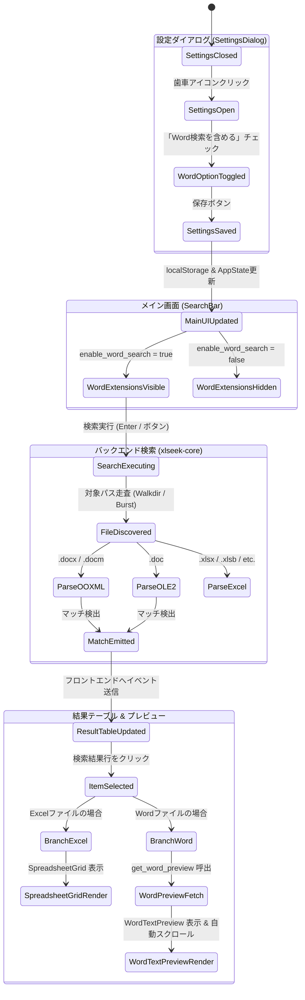

# Phase 1 データモデル設計: MS Word ドキュメント検索

**機能ブランチ**: `024-word-doc-search`  
**日付**: 2026-10-15  
**仕様書**: [spec.md](./spec.md) | **調査レポート**: [research.md](./research.md)

---

## 1. エンティティ定義

### 1.1 `WordSearchConfig` (設定モデル)

ユーザーが設定画面で管理する Word 検索の動作構成。

```typescript
// Frontend: src/types/defaultOptions.ts (拡張)
export interface DefaultSearchOptions {
  match_case: boolean;
  use_regex: boolean;
  include_formula: boolean;
  include_shape: boolean;
  include_comment: boolean;
  include_hidden: boolean;
  extensions: string[];
  directory_mode: "sequential" | "burst";
  burst_workers: number | null;
  // 新設フィールド
  enable_word_search: boolean; // 初期値: false (オプトイン)
}
```

- **永続化**: `localStorage.getItem("xlseek_default_options")`
- **制約**:
  - `enable_word_search === false` の場合、メイン画面の拡張子バーには Excel 拡張子（`.xlsx`, `.xlsm`, `.xls`, `.xlsb`）のみが表示される。
  - `enable_word_search === true` の場合、`.docx`, `.docm`, `.doc` が拡張子バーに動的に追加され、ユーザーが個別に選択/除外できる。

---

### 1.2 `MatchType` (検索ヒット種別の拡張)

Rust バックエンドおよび TypeScript フロントエンドのヒット種別列挙型。

```rust
// Backend: crates/core/src/models/mod.rs
#[derive(Debug, Clone, Copy, PartialEq, Eq, Serialize, Deserialize)]
pub enum MatchType {
    CellValue,
    Formula,
    Comment,
    HiddenSheet,
    Shape,
    // 新設バリアント
    WordText,
}
```

```typescript
// Frontend: src/types/search.ts
export type MatchType = 
  | "CellValue"
  | "Formula"
  | "Comment"
  | "HiddenSheet"
  | "Shape"
  | "WordText"; // 新設
```

---

### 1.3 `SearchMatch` (検索結果エンティティ)

Word 文書ヒット時の各フィールドの格納ルール：

| フィールド | 型 | Word 検索ヒット時の値 | 説明 |
|---|---|---|---|
| `id` | `u64` | 一意なインクリメンタル ID | 既存と同様 |
| `file_name` | `String` | ファイル名（例: `report.docx`） | 既存と同様 |
| `full_path` | `String` | 絶対パス | 既存と同様 |
| `sheet_name` | `String` | `"Word"` | 仕様 FR-008 準拠 |
| `cell_address` | `String` | `"-"` (または `"¶12"`) | 仕様 FR-008 準拠 |
| `row_index` | `u32` | 段落番号 (1-based) | ヒットした段落の出現順インデックス |
| `col_index` | `u32` | `0` | 固定値 |
| `col_name` | `String` | `""` | 空文字 |
| `match_type` | `MatchType` | `WordText` / `Comment` / `Shape` | 本文段落なら `WordText`、コメントなら `Comment`、図形内なら `Shape` |
| `shape_name` | `Option<String>` | 図形名または `None` | 図形内ヒット時のみ設定 |
| `sheet_hidden` | `bool` | `false` | 固定値 |
| `snippet` | `String` | ハイライト用マークアップスニペット | マッチ周辺の文字列 |
| `full_content` | `String` | 段落全体の完全なテキスト | プレビューおよびツールチップ用 |
| `formula` | `Option<String>` | `None` | 固定値 |
| `sheets_in_workbook`| `Vec<String>` | `vec!["Word".to_string()]` | 固定値 |

---

### 1.4 `WordPreviewPayload` (プレビュー転送データモデル)

Tauri IPC コマンド `get_word_preview` の返却ペイロード。

```rust
// Backend: crates/core/src/models/mod.rs または src-tauri/src/commands/preview_cmd.rs
#[derive(Debug, Clone, Serialize, Deserialize)]
pub struct WordParagraph {
    pub index: u32,             // 1-based の段落番号
    pub text: String,           // 段落プレーンテキスト
    pub is_target: bool,        // 検索結果で選択された対象段落かどうかのフラグ
}

#[derive(Debug, Clone, Serialize, Deserialize)]
pub struct WordPreviewPayload {
    pub file_path: String,
    pub file_name: String,
    pub target_paragraph: u32,
    pub total_paragraphs: usize,
    pub paragraphs: Vec<WordParagraph>,
}
```

```typescript
// Frontend: src/types/preview.ts
export interface WordParagraph {
  index: number;
  text: string;
  is_target: boolean;
}

export interface WordPreviewPayload {
  file_path: string;
  file_name: string;
  target_paragraph: number;
  total_paragraphs: number;
  paragraphs: WordParagraph[];
}
```

---

## 2. 状態遷移とライフサイクル



---

## 3. バリデーションルール

1. **拡張子バリデーション**:
   - Word 検索拡張子は固定ホワイトリスト（`"docx"`, `"docm"`, `"doc"`）のみを許容。大文字・小文字はスキャン時に正規化（`.to_lowercase()`）。
2. **段落インデックス境界値**:
   - `target_paragraph` は `1` 以上 `total_paragraphs` 以下の正の整数。範囲外の場合は先頭段落（`1`）へフォールバック。
3. **破損・保護ファイル耐性**:
   - ZIP コンテナ破損やパスワード暗号化（`EncryptedPackage`）を検出した場合、クラッシュせず `SearchIssue`（またはスキップログ）を記録し、他のファイルのスキャンを中断しない。
