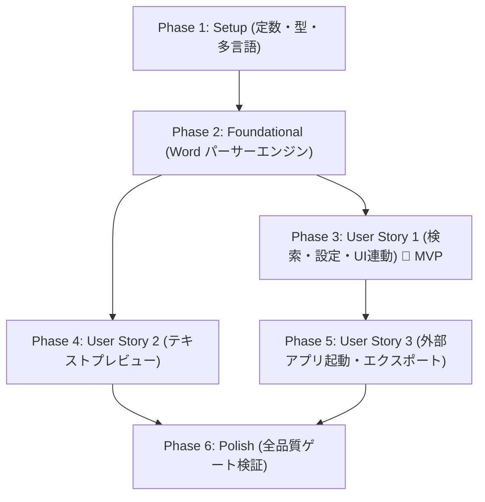

# タスク一覧: MS Word ドキュメント検索 (.doc, .docx, .docm)

**機能ブランチ**: `024-word-doc-search`  
**実装計画書**: [plan.md](./plan.md) | **仕様書**: [spec.md](./spec.md) | **設計書**: [data-model.md](./data-model.md)

---

## Phase 1: Setup（共通基盤・定数定義）

**目的**: 全レイヤー（コア、Tauriバックエンド、フロントエンド）にわたる定数定義と多言語キーの一元管理（憲法 原則 II・原則 III 準拠）。

- [X] T001 `crates/core/src/constants.rs` に Word 拡張子（`"docx"`, `"docm"`, `"doc"`）、固定ラベル（`"Word"`, `"-"`）、および検索定数を定義
- [X] T002 [P] `src-tauri/src/constants.rs` に Tauri IPC コマンド名 `CMD_GET_WORD_PREVIEW`（`"get_word_preview"`）およびエラーコード定数を定義
- [X] T003 [P] `src/constants/index.ts` にフロントエンド用 Word コマンド、拡張子リスト、および UI 定数を定義
- [X] T004 [P] `crates/core/locales/ja.yml` および `crates/core/locales/en.yml` に Word 検索オプション名、プレビュー表示用メッセージの多言語翻訳キーを追加

---

## Phase 2: Foundational（基盤処理・Word パーサーエンジン実装）

**目的**: 全ユーザーストーリー共通の前提となるコア Word 解析エンジンの実装。

**⚠️ クリティカル**: 本フェーズの完了前にはユーザーストーリーの実装に着手できません。

- [X] T005 `crates/core/src/models/mod.rs` に `MatchType::WordText` バリアントおよびプレビュー用データ構造体 `WordPreviewPayload`, `WordParagraph` を定義
- [X] T006 [P] `crates/core/src/search/word/docx.rs` を新規作成し、`zip` と `quick-xml` を用いて `.docx` および `.docm` の本文（`word/document.xml`）、ヘッダー/フッター、コメント、図形テキストを抽出するストリーミングパーサーを実装
- [X] T007 [P] `crates/core/src/search/word/doc.rs` を新規作成し、`cfb` と `encoding_rs` を用いてバイナリ `.doc`（OLE2）の `WordDocument` ストリームから CP932/UTF-16LE テキストを抽出するパーサーを実装
- [X] T008 `crates/core/src/search/word/mod.rs` を作成し、拡張子（`.docx`, `.docm`, `.doc`）に応じたパーサーディスパッチ関数 `search_word_file` および全文プレビュー抽出関数 `extract_word_document` を実装
- [X] T009 `crates/core/src/search/mod.rs` で `word` モジュールを公開し、`crates/core/tests/word_search.rs` に `.docx`, `.docm`, `.doc` のテキスト抽出・検索結合テストを追加

**チェックポイント**: 基盤完了 - コアの Word テキスト抽出エンジンが単体で検証可能な状態

---

## Phase 3: User Story 1 - Word 文書の検索と設定・UI連動 (Priority: P1) 🎯 MVP

**ゴール**: 設定画面で Word 検索を有効化でき、メイン画面で `.docx`, `.docm`, `.doc` を選択して検索を実行、結果一覧に表示される。

**独立テスト基準**: 設定画面で Word 検索を有効にし、Word 文書を含むフォルダを検索して、結果テーブルにシート「Word」、セル「-」、キーワードスニペットが正しく表示されることを確認。

### ユーザーストーリー 1 の実装タスク

- [X] T010 [US1] `crates/core/src/search/engine.rs` を更新し、走査対象拡張子に Word 拡張子が含まれる場合に `search_word_file` を呼び出すルーティングと `SearchMatch` 生成処理を統合
- [X] T011 [P] [US1] `src/types/defaultOptions.ts` および `src/types/search.ts` に `enable_word_search` プロパティおよび `WordText` マッチ型定義を追加
- [X] T012 [P] [US1] `src/default-options-core.ts` および `src/settings-core.ts` を更新し、`enable_word_search` の初期値（`false`）および永続化バリデーションを実装
- [X] T013 [US1] `src/components/settings/SettingsDialog.tsx` の検索設定ページに「Word文書も検索対象に含める (.docx, .docm, .doc)」トグルオプションを追加
- [X] T014 [US1] `src/components/search/SearchBar.tsx` を更新し、`enable_word_search` 有効時に `.docx`, `.docm`, `.doc` のトグルボタンを動的表示し、個別オン/オフを可能にする
- [X] T015 [US1] `src/components/results/ResultTable.tsx` を更新し、Word 検索結果行のシート列「Word」、セル列「-」の表示および Word アイコンのレンダリングに対応

**チェックポイント**: ユーザーストーリー 1 (MVP) が単独で動作・テスト可能

---

## Phase 4: User Story 2 - Word 検索結果のテキスト形式プレビュー (Priority: P1)

**ゴール**: Word 検索結果行をクリックした際、スプレッドシート用グリッドではなく、段落番号・自動スクロール・キーワード強調付きのテキストプレビューを表示する。

**独立テスト基準**: Word 検索結果をクリックし、右ペインにテキストビューワーが表示され、該当ヒット箇所へ自動スクロールしてキーワードがハイライト表示されることを確認。

### ユーザーストーリー 2 の実装タスク

- [X] T016 [US2] `src-tauri/src/commands/preview_cmd.rs` に `get_word_preview(file_path: String, target_paragraph: u32) -> Result<WordPreviewPayload, CommandError>` コマンドを実装し、`src-tauri/src/lib.rs` に登録
- [X] T017 [P] [US2] `src/types/preview.ts` に `WordPreviewPayload` および `WordParagraph` の TypeScript 型定義を追加
- [X] T018 [US2] `src/components/preview/WordTextPreview.tsx` を新規作成し、段落番号付きテキスト表示、キーワードハイライト、およびマウント/選択変更時の対象段落への自動スクロール（`scrollIntoView`）を実装
- [X] T019 [US2] `src/App.tsx` のプレビュー表示領域を改修し、選択された `SearchMatch` が Word 文書の場合に `get_word_preview` を呼び出して `WordTextPreview` を描画する条件分岐を統合

**チェックポイント**: ユーザーストーリー 1 および 2 が連携して動作し、検索からテキストプレビューまでシームレスに機能

---

## Phase 5: User Story 3 - 検索結果のナビゲーションと外部アプリ起動 (Priority: P2)

**ゴール**: Word 検索結果行のダブルクリックまたはアクション操作により、OS 既定の Word プロセッサで該当ファイルが開き、包含フォルダの表示も正常に動作する。

**独立テスト基準**: Word 検索結果をダブルクリックし、OS 規定のワードプロセッサでファイルが開くこと、およびエクスポートが正しく行われることを確認。

### ユーザーストーリー 3 の実装タスク

- [X] T020 [US3] `src/components/preview/PreviewHeader.tsx` を確認・更新し、Word 文書ファイル選択時にも「ファイルを開く」「フォルダを開く」ボタンが正常に動作し、ファイル情報が適切に表示されるよう調整
- [X] T021 [US3] `crates/core/src/export/csv_export.rs` および `xlsx_export.rs` で Word 検索結果が含まれている場合にもカラムずれなく正常に出力されることを単体テストで検証・調整

**チェックポイント**: 全ユーザーストーリーが独立かつ協調して完全動作

---

## Phase 6: Polish & Cross-Cutting Concerns（品質検証・結合確認）

**目的**: プロジェクト全体の品質ゲート（テスト、リンター、フォーマット）の完全通過と回帰防止。

- [X] T022 [P] `cargo test --workspace` を実行し、すべての単体テスト・結合テストがパスすることを確認
- [X] T023 [P] `npm run build` を実行し、TypeScript 型エラー（`tsc`）ゼロおよび Vite バンドルが正常完了することを確認
- [X] T024 [P] `cargo clippy --workspace --all-targets -- -D warnings` および `cargo fmt --check` を実行し、Rust コード規約を完全遵守していることを確認
- [X] T025 `specs/024-word-doc-search/quickstart.md` の検証シナリオに沿って、エンドツーエンドでの動作確認を実施

---

## 依存関係と実行順序

### フェーズ間の依存関係

- **Phase 1 (Setup)**: 依存関係なし。即座に着手可能。
- **Phase 2 (Foundational)**: Phase 1 完了後に着手。全ユーザーストーリーの前提。
- **Phase 3 (User Story 1 - MVP)**: Phase 2 完了後に着手可能。
- **Phase 4 (User Story 2)**: Phase 2 完了後に着手可能（US1 と並行開発可能）。
- **Phase 5 (User Story 3)**: US1 の結果テーブル統合後に着手。
- **Phase 6 (Polish)**: すべてのユーザーストーリー完了後に着手。

---

## 並行実行可能タスクの例

### Phase 1 (Setup)
- `T002`（Tauri 定数）、`T003`（フロントエンド定数）、`T004`（多言語カタログ）は `T001` と並行して実行可能。

### Phase 2 (Foundational)
- `T006`（`.docx`/`.docm` パーサー `docx.rs`）と `T007`（`.doc` パーサー `doc.rs`）は完全に独立したファイルであるため並行して実装可能。

### Phase 3 & Phase 4
- バックエンドのプレビュー IPC コマンド（`T016`）とフロントエンドの UI コンポーネント（`T018`）はインターフェース契約（`contracts/word-search-contract.md`）に基づいて並行して作業可能。

---

## 実装戦略

### 1. MVP ファースト（User Story 1 の先行完成）
1. Phase 1 (Setup) および Phase 2 (Foundational) を完了。
2. Phase 3 (User Story 1) を実装し、設定画面から Word 検索を有効にして検索結果テーブルにヒットが表示されることを確認。
3. **ここで検証**: 検索機能としての最小価値（MVP）を独立確認。

### 2. インクリメンタルな拡張（User Story 2 & 3 の追加）
1. Phase 4 (User Story 2) を実装し、選択された Word 検索結果に対するテキストプレビューと自動スクロールを追加。
2. Phase 5 (User Story 3) を実装し、外部アプリ起動とエクスポート機能の動作を保証。
3. Phase 6 (Polish) で `cargo test`, `npm run build`, `cargo clippy`, `cargo fmt` を実行し、品質ゲートを全クリア。
