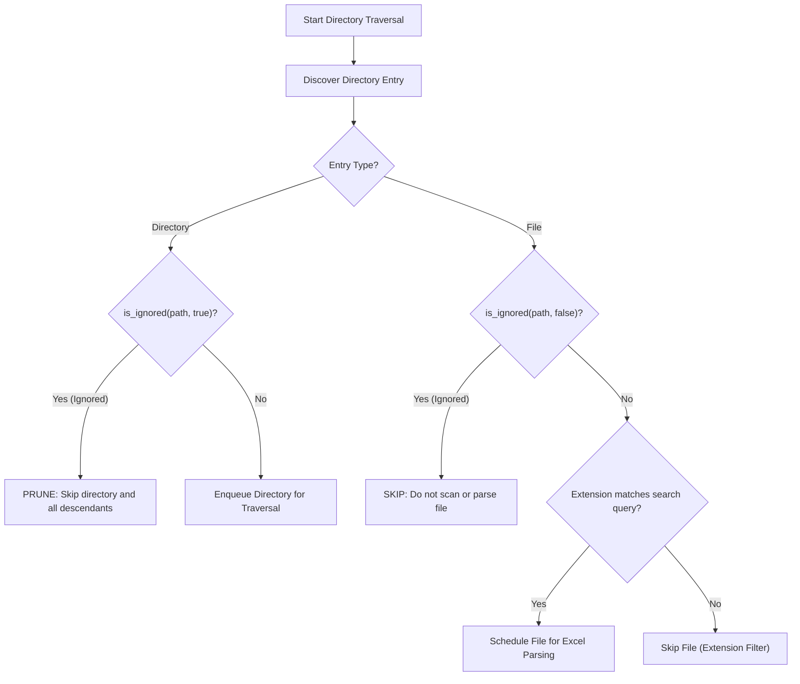
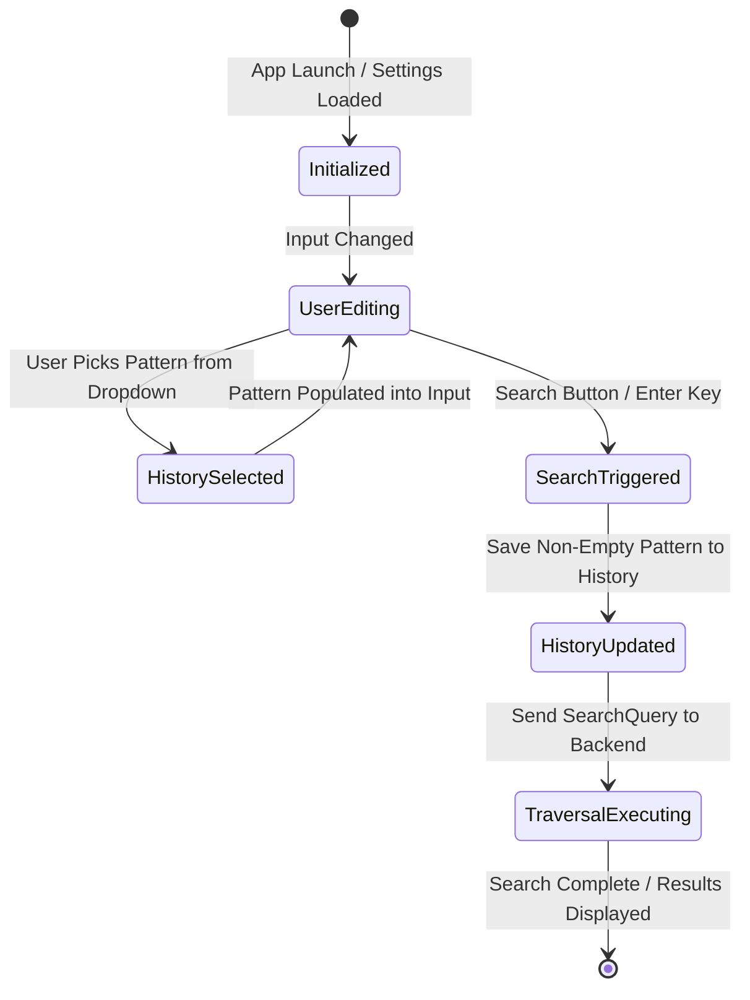

# Data Model: Ignore File Patterns with Gitignore-Style Matching and History

**Feature**: `025-ignore-file-patterns`  
**Date**: 2026-10-15  
**Status**: Complete

---

## 1. Domain Entities & Type Definitions

### 1.1 `SearchQuery` Extension

`SearchQuery` represents search execution parameters submitted from the GUI or CLI. It is extended with an optional `ignore_patterns` field.

#### Rust Representation (`crates/core/src/models/query.rs`)
```rust
#[derive(Debug, Clone, PartialEq, Eq, Serialize, Deserialize)]
pub struct SearchQuery {
    pub target_directory: String,
    pub keyword: String,
    pub is_regex: bool,
    pub case_sensitive: bool,
    pub match_whole_word: bool,
    pub search_targets: SearchTargets,
    pub extensions: Vec<String>,
    pub max_results: usize,
    /// Comma-separated gitignore-style exclusion patterns (e.g., `"~$*, *.tmp, backup/"`).
    /// If None or empty/whitespace, no ignore filtering is applied.
    pub ignore_patterns: Option<String>,
}
```

#### TypeScript Representation (`src/types/search.ts`)
```typescript
export interface SearchQuery {
  targetDirectory: string;
  keyword: string;
  isRegex: boolean;
  caseSensitive: boolean;
  matchWholeWord: boolean;
  searchTargets: SearchTargets;
  extensions: string[];
  maxResults: number;
  /**
   * Comma-separated gitignore-style ignore patterns (e.g., `"~$*, *.tmp, node_modules/"`).
   */
  ignorePatterns?: string;
}
```

---

### 1.2 `IgnoreMatcher` Domain Engine (`crates/core/src/search/ignore.rs`)

`IgnoreMatcher` wraps the gitignore matching engine and evaluates candidate file and directory paths during discovery.

```rust
use std::path::Path;
use ignore::gitignore::Gitignore;

/// Evaluates file and directory paths against gitignore-style rules.
pub struct IgnoreMatcher {
    /// Inner compiled gitignore DFA matcher, or None if no rules were specified.
    inner: Option<Gitignore>,
}

impl IgnoreMatcher {
    /// Constructs an `IgnoreMatcher` from a search root directory and a comma-separated pattern string.
    ///
    /// # Arguments
    /// * `root` - Base path used to resolve relative pattern anchors.
    /// * `raw_patterns` - Comma-delimited list of glob/gitignore patterns.
    ///
    /// # Returns
    /// * `Ok(Self)` if all patterns compile successfully or if patterns are empty.
    /// * `Err(CoreError)` if pattern syntax is invalid.
    pub fn from_patterns(root: &Path, raw_patterns: Option<&str>) -> Result<Self, CoreError>;

    /// Tests whether a candidate path matches any active ignore rule.
    ///
    /// # Arguments
    /// * `path` - Candidate filesystem path (file or directory).
    /// * `is_dir` - True if evaluating a directory; false for regular files.
    ///
    /// # Returns
    /// * `true` if the path should be ignored.
    /// * `false` if the path should be scanned.
    pub fn is_ignored(&self, path: &Path, is_dir: bool) -> bool;

    /// Returns a passthrough matcher that never ignores any path.
    pub fn passthrough() -> Self;
}
```

---

### 1.3 `IgnoreHistoryStore` (`src/utils/ignoreHistory.ts`)

Manages client-side persistence of recently used ignore pattern strings in `localStorage`.

```typescript
export interface IgnoreHistoryStore {
  /**
   * Loads recent ignore pattern strings from localStorage.
   * Returns empty array if no history exists.
   */
  load(): string[];

  /**
   * Appends or promotes a pattern string to the front of history.
   * Deduplicates case-sensitively, trims whitespace, limits to 20 entries.
   * Does nothing if pattern is empty or whitespace-only.
   */
  save(pattern: string): void;

  /**
   * Clears all stored ignore pattern history.
   */
  clear(): void;
}
```

#### Storage Format
- **Key**: `"xlseek.ignorePatternHistory"`
- **Value**: JSON-encoded array of strings, e.g. `["~$*", "~$*, *.tmp", "backup/*"]`
- **Max Items**: 20 entries (LRU/MRU ordering; most recent at index 0)

---

### 1.4 `DefaultSearchOptions` Extension (`src/settings-core.ts` & `src/types/settings.ts`)

Extends persistent user defaults with a baseline ignore pattern string.

```typescript
export interface DefaultSearchOptions {
  caseSensitive: boolean;
  matchWholeWord: boolean;
  isRegex: boolean;
  searchTargets: SearchTargets;
  extensions: string[];
  maxResults: number;
  /**
   * Baseline default ignore patterns loaded into new search sessions.
   * Defaults to `"~$*"`.
   */
  ignorePatterns: string;
}
```

#### Storage Format
- **Key**: `"xlseek.default_search_options"`
- **Default value for `ignorePatterns`**: `"~$*"`

---

## 2. Validation & Tokenization Rules

### 2.1 Comma-Separated Pattern String Parsing
Pattern strings are split into discrete pattern tokens using the same delimiter logic as search paths:
1. Split input by comma (`,`), except commas enclosed in double quotes (`"`).
2. For each token:
   - Strip leading and trailing double quotes if enclosed.
   - Trim leading and trailing whitespace.
   - Ignore empty tokens (handles `, ,`, leading commas, trailing commas).
3. If no non-empty tokens remain, treat as no ignore filtering (passthrough).

#### Parsing Examples:
| Input String | Parsed Patterns | Note |
| :--- | :--- | :--- |
| `~$*` | `["~$*"]` | Default lock file pattern |
| `~$*, *.tmp, backup/` | `["~$*", "*.tmp", "backup/"]` | Multiple patterns with spacing |
| ` , ~$* , , ` | `["~$*"]` | Tolerates redundant commas and whitespace |
| `"backup, old/*", ~$*` | `["backup, old/*", "~$*"]` | Quoted commas preserved |
| `""` or `" "` | `[]` | Empty: passthrough |

---

## 3. Traversal Lifecycle & Evaluation Flow



---

## 4. State Transitions for Search Input


