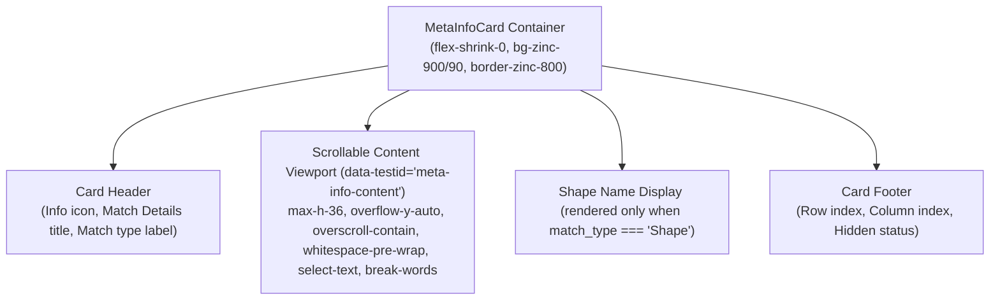

# Data Model: Scrollable Match Detail Area in Search Preview

**Feature Branch**: `029-detail-view-scroll` | **Date**: 2026-10-22 | **Spec**: [spec.md](./spec.md)

This document formalizes the entities, data structures, layout constants, and component relationships for Feature 029.

---

## 1. Domain Entities and Type Definitions

This feature builds upon the existing search result model `SearchMatch` by adding layout constraints and scrolling behaviors to the preview presentation layer. No new backend data models or database migrations are required.

### 1.1 `SearchMatch` (Existing Model Reference)
Represents a matched cell, shape, comment, or Word paragraph returned by the search engine (`src/types/search.ts`).

| Field Name | Type (TypeScript) | Description |
|---|---|---|
| `id` | `number` | Unique identifier of the search match item |
| `file_name` | `string` | File name (e.g. `DIANA_Interface_Report.xlsx`) |
| `full_path` | `string` | Absolute path to the source workbook |
| `sheet_name` | `string` | Target worksheet name (e.g. `01_Summary`) |
| `cell_address` | `string` | Excel cell coordinate (e.g. `A16`) |
| `row_index` | `number` | 1-based row index (`16`) |
| `col_index` | `number` | 1-based column index (`1`) |
| `col_name` | `string` | Column letter designation (`A`) |
| `match_type` | `SearchMatchType` | Match category (`"CellValue" \| "Formula" \| "Comment" \| "HiddenSheet" \| "Shape" \| "WordText"`) |
| `shape_name` | `string \| null` | Name of the shape (when match_type is Shape) |
| `sheet_hidden` | `boolean` | Indicates whether the containing sheet is hidden |
| `snippet` | `string` | Excerpt highlighting matched query keywords |
| `full_content` | `string` | **Full text content of the target cell/element** (target of scrolling) |
| `formula` | `string \| null` | Underlying cell formula string if present |
| `sheets_in_workbook`| `string[]` | List of all sheet names in the workbook |

---

## 2. Component and UI Layout Definitions

### 2.1 `MetaInfoCardProps`
Properties accepted by `src/components/preview/MetaInfoCard.tsx`.

```typescript
interface MetaInfoCardProps {
  /** Currently selected search match, or null if no selection is active */
  match: SearchMatch | null;
}
```

### 2.2 Layout Constants (`src/constants/index.ts`)
In compliance with Constitution Principle II (No Hardcoded Constants), layout dimensions and test attributes are added to `LAYOUT_CONSTANTS`:

```typescript
export const LAYOUT_CONSTANTS = {
  // ... existing constants ...

  /** Match detail content container max height Tailwind utility class */
  META_DETAIL_MAX_HEIGHT_CLASS: "max-h-36",
  /** Match detail content container max height in pixels (144px) */
  META_DETAIL_MAX_HEIGHT_PX: 144,
  /** Test identifier attribute for the scrollable match detail content element */
  META_DETAIL_TEST_ID: "meta-info-content",
} as const;
```

---

## 3. UI Component Structure and Visual Styling

### 3.1 `MetaInfoCard` Element Hierarchy



### 3.2 Detail Content Viewport Style Attributes

| Class / Property | Design Purpose |
|---|---|
| `max-h-36` (`9rem` / `144px`) | Caps the vertical height of the detail text so that `SpreadsheetGrid` retains ample vertical display space |
| `overflow-y-auto` | Enables vertical scrolling only when content exceeds the 144px boundary; stays clean when text is short |
| `overscroll-contain` | Prevents scroll chaining to parent preview pane or root window when reaching scroll limits |
| `whitespace-pre-wrap` | Preserves newline formatting (`\n`, `\r\n`) and wraps text lines cleanly at container edges |
| `select-text` | Enables seamless mouse and keyboard text selection and clipboard copying |
| `break-words` | Prevents long contiguous alphanumeric strings from overflowing horizontally |
| `font-mono` | Monospaced typography for structured readability of formulas, numbers, and text |
| `text-[11px]` | Compact font sizing harmonized with the dark preview interface |
