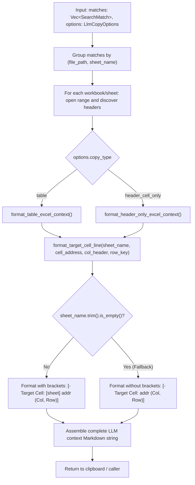

# Data Model: Explicit Sheet Tab Name in AI Copy Target Cell Metadata

**Feature Branch**: `030-ai-copy-tab-name` | **Date**: 2026-10-23 | **Spec**: [spec.md](./spec.md)

This document describes the entities, data structures, and formatted output schemas involved in Feature 030.
Per Constitution Principle III and Section 2.3/3.3, all examples use synthetic dummy data.

---

## 1. Domain Entities & Rust Data Structures

### `SearchMatch` (Existing Model in `xlseek-core`)
Represents an individual search hit within an Excel workbook or Word document:

```rust
pub struct SearchMatch {
    pub file_path: String,
    pub file_name: String,
    pub sheet_name: String,       // Worksheet tab name (e.g., "Sheet1", "Summary")
    pub cell_address: String,     // Excel cell coordinate (e.g., "B2", "C5")
    pub matched_value: String,    // Matched substring or cell text
    pub full_content: String,     // Full raw text of the matched cell
    pub row_index: u32,           // 0-indexed row position
    pub col_index: u32,           // 0-indexed column position
    // ... additional search metadata
}
```

### `LlmCopyOptions` (Existing Model in `xlseek-core`)
Options configuring how LLM context text is generated:

```rust
pub struct LlmCopyOptions {
    pub copy_type: String,        // "table" or "header_cell_only"
    pub column_window_size: u32,  // Number of adjacent columns (default 5, min 1, max 20)
    pub word_mode: String,        // "headings_and_paragraph" or "paragraph_only"
}
```

---

## 2. Target Cell Output Schema

The generated markdown structure contains a section header, target cell descriptors, and either a table or header-only content block.

### Structure Definition

```text
### {file_name} - {sheet_name}
- Target Cell: [{sheet_name}] {cell_address} (Column: {column_header}, Row: {row_key})
  - Matched Value: **{display_val}**

{table_or_header_content}
```

### Formatting Rules

| Attribute | Format Rule | Example |
|---|---|---|
| Non-empty `sheet_name` | `- Target Cell: [{sheet_name}] {cell_address} (Column: {column_header}, Row: {row_key})` | `- Target Cell: [Sheet1] B2 (Column: Status, Row: Item 1)` |
| Empty / whitespace `sheet_name` | `- Target Cell: {cell_address} (Column: {column_header}, Row: {row_key})` | `- Target Cell: B2 (Column: Status, Row: Item 1)` |
| Special characters in `sheet_name` | Direct literal enclosure in brackets | `- Target Cell: [FY2026 Q3 (Final)] C10 (Column: Sales, Row: Q3)` |
| `column_header` fallback | `Column {c + 1}` if no header detected | `Column 1` |
| `row_key` fallback | `Row {r + 1}` if no row key detected | `Row 16` |

---

## 3. Formatting Flow


