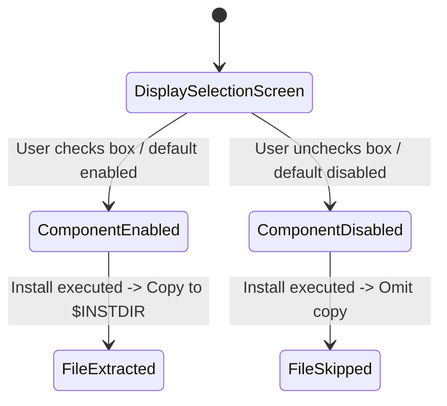

# Data Model: Windows Installer Component Selection for xlseek-mcp and xlseek-cli

## Entity 1: SidecarBuildTarget

Represents an external binary to be built and staged for desktop bundling.

### Fields
- `packageName` (string): The Cargo package name (e.g., `"sample-pkg-cli"`, `"sample-pkg-mcp"`).
- `binaryName` (string): The executable binary name (e.g., `"sample-cli"`, `"sample-mcp"`).
- `sidecarBasePath` (string): Relative base path in Tauri bundle config (e.g., `"binaries/sample-cli"`).
- `sourceArtifact` (path): Derived release path (e.g., `target/<target-triple>/release/<binaryName>[.exe]`).
- `stagedArtifact` (path): Staging location (e.g., `src-tauri/binaries/<binaryName>-<target-triple>[.exe]`).

### Validation Rules
- `targetTriple` must match regex `/^[A-Za-z0-9_]+(?:-[A-Za-z0-9_]+){2,}$/`.
- `sourceArtifact` must exist on disk before staging.

---

## Entity 2: InstallerComponentDefinition

Represents a user-selectable component in the Windows installation wizard.

### Fields
- `id` (string): Unique identifier (e.g., `SecCore`, `SecCli`, `SecMcp` in NSIS; `MainProgram`, `CliFeature`, `McpFeature` in WiX).
- `title` (string): Visible label in wizard (e.g., `"Excel Seek (GUI)"`, `"xlseek-cli (CLI)"`, `"xlseek-mcp (MCP Server)"`).
- `description` (bilingual string): Descriptive tooltip or text explaining purpose.
- `defaultState` (enum: `Mandatory`, `Enabled`, `Disabled`):
  - `Mandatory`: Locked ON (`SectionIn RO` in NSIS; `Absent="disallow"` in WiX).
  - `Enabled`: Checked ON by default (`Section` in NSIS; `Level="1"` in WiX).
  - `Disabled`: Checked OFF by default (`Section /o` in NSIS; `Level="2"` in WiX).
- `targetBinary` (string, optional): Filename copied if enabled (e.g., `"sample-cli.exe"`, `"sample-mcp.exe"`).

### State Transitions

---

## Entity 3: DesktopDistributionBundle

Represents an installable package generated for a target platform.

### Fields
- `targetPlatform` (string): e.g., `"x86_64-pc-windows-msvc"`, `"aarch64-apple-darwin"`, `"x86_64-unknown-linux-gnu"`.
- `packageFormat` (enum): `NSIS_EXE`, `WIX_MSI`, `MACOS_DMG`, `LINUX_DEB`, `LINUX_APPIMAGE`.
- `includedBinaries` (list of strings): Executables bundled in this distribution package.
