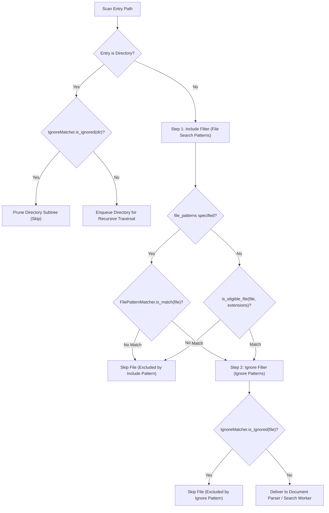

# Data Model: File Search Patterns with Extension Complement and Sequential Filtering

**Feature**: `037-file-search-patterns`  
**Date**: 2026-10-27  
**Status**: Complete  

---

## 1. Domain Entities & Type Definitions

### 1.1 `SearchQuery` Extension

`SearchQuery` encapsulates search execution parameters submitted from GUI, CLI, or MCP interfaces. It is extended with an optional `file_patterns` field.

#### Rust Model (`crates/core/src/models/mod.rs`)
```rust
#[derive(Debug, Clone, PartialEq, Eq, Serialize, Deserialize)]
pub struct SearchQuery {
    pub keyword: String,
    pub target_dir: String,
    pub directory_mode: DirectorySearchMode,
    pub burst_workers: Option<usize>,
    pub match_case: bool,
    pub include_value: bool,
    pub use_regex: bool,
    pub include_formula: bool,
    pub include_comment: bool,
    pub include_shape: bool,
    pub include_hidden: bool,
    pub extensions: Vec<String>,
    pub ignore_patterns: Option<String>,
    /// Comma-separated inclusion file search patterns (e.g. `"*budget*, quarterly_*"`).
    /// If None or empty, defaults to matching all files with enabled extensions.
    pub file_patterns: Option<String>,
}
```

#### TypeScript Model (`src/types/search.ts`)
```typescript
export interface SearchQuery {
  keyword: string;
  targetDir: string;
  directoryMode: DirectorySearchMode;
  burstWorkers?: number;
  matchCase: boolean;
  includeValue: boolean;
  useRegex: boolean;
  includeFormula: boolean;
  includeComment: boolean;
  includeShape: boolean;
  includeHidden: boolean;
  extensions: string[];
  ignorePatterns?: string;
  /**
   * Comma-separated inclusion file search patterns (e.g., `"*report*, budget*"`).
   */
  filePatterns?: string;
}
```

---

### 1.2 `FilePatternMatcher` (`crates/core/src/search/pattern.rs`)

`FilePatternMatcher` parses inclusion pattern tokens, executes extension complement, and compiles rules into an inner glob evaluator.

```rust
use ignore::gitignore::Gitignore;
use std::path::Path;

/// Evaluates candidate file paths against compiled inclusion file search patterns.
#[derive(Debug, Clone)]
pub struct FilePatternMatcher {
    /// Compiled gitignore-style matcher over complemented patterns.
    /// None when patterns are omitted or whitespace, indicating passthrough mode.
    inner: Option<Gitignore>,
    /// Set of complemented pattern strings (for diagnostics and test verification).
    complemented_patterns: Vec<String>,
    /// Indicates whether any pattern explicitly specified a file extension.
    has_explicit_extensions: bool,
}

impl FilePatternMatcher {
    /// Compiles a `FilePatternMatcher` from raw pattern string and active extension options.
    pub fn from_patterns(
        root: &Path,
        raw_patterns: Option<&str>,
        enabled_extensions: &[String],
    ) -> Result<Self, String>;

    /// Creates a passthrough matcher when no file search patterns are specified.
    pub fn passthrough() -> Self;

    /// Evaluates whether a candidate file satisfies active inclusion criteria.
    pub fn is_match(&self, path: &Path, enabled_extensions: &[String]) -> bool;

    /// Determines whether a pattern token explicitly specifies a recognized file extension.
    pub fn has_explicit_extension(pattern: &str) -> bool;

    /// Complements extensionless tokens with active extensions while preserving explicit extensions.
    pub fn complement_tokens(tokens: &[String], enabled_extensions: &[String]) -> Vec<String>;
}
```

---

### 1.3 `SearchOptionsConfig` Extension (Saved Defaults Settings)

Configuration stored in settings is extended with a default pattern preference.

#### Rust Settings Model
```rust
#[derive(Debug, Clone, PartialEq, Eq, Serialize, Deserialize)]
pub struct SearchOptionsConfig {
    pub match_case: bool,
    pub use_regex: bool,
    pub include_value: bool,
    pub include_formula: bool,
    pub include_comment: bool,
    pub include_shape: bool,
    pub include_hidden: bool,
    pub extensions: Vec<String>,
    pub ignore_patterns: String,
    /// Default file search patterns initialized in new sessions (default: `""`).
    pub default_file_patterns: String,
}
```

#### TypeScript Settings Model (`src/settings-core.ts`)
```typescript
export interface SearchOptionsConfig {
  matchCase: boolean;
  useRegex: boolean;
  includeValue: boolean;
  includeFormula: boolean;
  includeComment: boolean;
  includeShape: boolean;
  includeHidden: boolean;
  extensions: string[];
  ignorePatterns: string;
  defaultFilePatterns: string;
}
```

---

### 1.4 `FilePatternHistory` Entity (Frontend Persistence)

Manages a persistent, deduplicated LRU collection of recently executed file search pattern strings.

- **Storage Key**: `constants::STORAGE_KEY_FILE_PATTERN_HISTORY` (`"xlseek.filePatternHistory"`)
- **Max Entries**: `constants::MAX_FILE_PATTERN_HISTORY_ENTRIES` (`20`)
- **Operations**:
  - `getFilePatternHistory(): string[]`
  - `addFilePatternHistory(pattern: string): string[]`
  - `clearFilePatternHistory(): void`

---

## 2. Sequential Traversal & Filtering Lifecycle



---

## 3. Validation Rules & Edge Cases

| Case | Input Example | Resolution / Output |
| :--- | :--- | :--- |
| **Empty or Whitespace** | `""` or `"   "` | Matches all files having active enabled extensions (`passthrough` mode). |
| **Extensionless Pattern** | `budget*` with `.xlsx`, `.xlsm` | Complements into `["budget*.xlsx", "budget*.xlsm"]`. |
| **Explicit Extension** | `summary.xlsx` | Preserved as `["summary.xlsx"]` without duplicate suffix. |
| **Explicit Override** | `*.xls` (when `.xls` is untoggled) | Matches `.xls` files (explicit extension takes precedence for supported formats). |
| **Mixed Patterns** | `budget*, report.xlsx, *audit*` | Complements extensionless tokens, preserves explicit extension tokens. |
| **Quoted Commas** | `"2024, Q1 Report*", summary*` | Preserves comma inside quotes as single token `"2024, Q1 Report*"`. |
| **Redundant Delimiters** | `, pattern1,, pattern2, ` | Parsed into `["pattern1", "pattern2"]`. |
| **Invalid Glob Syntax** | `[unclosed-bracket` | Non-fatal issue report; falls back to passthrough without crashing. |
